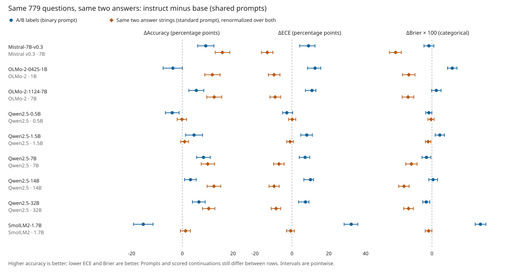

# tithe

I compared the calibration of nine base/instruct model pairs under two evaluation setups, on the same 779 TruthfulQA questions with the same two candidate answers each, and the two setups point in opposite directions.

With a zero-shot A/B prompt that scores the answer letter, the instruct model's expected calibration error (ECE) rose in eight of nine pairs, all eight with 95% intervals above zero. With the lm-evaluation-harness six-shot prompt that scores the full answer text, ECE fell in eight pairs, six with intervals below zero. The setups differ in both prompt and scored text, so this shows that they disagree, not which difference causes it.



Change in expected calibration error (ECE) from base to instruct, in percentage points. Positive is worse. A star means the 95% interval excludes zero.

| Pair | A/B label | Full answer |
|---|---:|---:|
| Mistral-7B-v0.3 | +9.0* | -13.4* |
| OLMo-2-1B | +12.5* | -9.7* |
| OLMo-2-7B | +10.9* | -9.1* |
| Qwen2.5-0.5B | -2.8 | +0.1 |
| Qwen2.5-1.5B | +8.0* | -1.0 |
| Qwen2.5-7B | +7.2* | -7.0* |
| Qwen2.5-14B | +10.1* | -9.7* |
| Qwen2.5-32B | +7.4* | -8.6* |
| SmolLM2-1.7B | +32.2* | -0.7 |

Intervals come from 10,000 paired resamples of the questions.

## One pair up close

Qwen2.5-7B, base → instruct:

| Scoring | Accuracy | Mean confidence |
|---|---:|---:|
| A/B label | 70% → 78% | 77% → 96% |
| Full answer | 45% → 55% | 93% → 96% |

On the label, tuning pushes confidence up 19 points while accuracy gains 8, so the gap between them grows. On full answers the base model is already 93% sure of itself while being right less than half the time. Tuning adds 10 points of accuracy and barely moves confidence, so the gap shrinks. The other pairs look the same: every base model sits at 92–94% confidence on full answers, and tuning moves that by 3.5 points at most.

On the standard 817-question TruthfulQA, instruction tuning also improves MC2 in 8 of 9 pairs and MC1 in 6.

## Rebuild from the saved scores

Install this checkout; the command is `tithe` and the Python package is `alignmenttax`.

```sh
uv sync --locked
uv run python -m alignmenttax.reanalysis    # a few minutes
uv run --extra dev pytest -q tests
```

The reanalysis rebuilds `results/reanalysis` and `results/day_scale/analysis`. Scoring models yourself needs `uv sync --extra full` and, for the larger models, a GPU; `tithe --help` lists the stages.

Question matching, prompts, metrics and the bootstrap are in [docs/method.md](docs/method.md).

TruthfulQA is by [Lin, Hilton and Evans](https://arxiv.org/abs/2109.07958). Temperature scaling follows [Guo et al.](https://arxiv.org/abs/1706.04599). Post-training calibration is also studied by [Kadavath et al.](https://arxiv.org/abs/2207.05221) and the [GPT-4 report](https://arxiv.org/abs/2303.08774). Data and code licenses: [`results/NOTICE.txt`](results/NOTICE.txt). Code is MIT.
