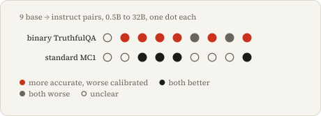
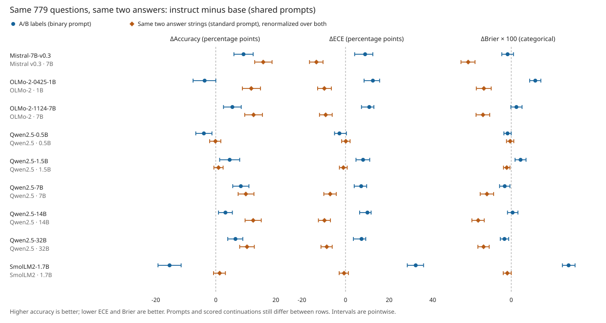

# tithe: TruthfulQA calibration of base and instruct models under two scoring rules

**On the same 779 questions and the same two answers, instruction tuning worsens calibration when I score the A/B label and improves it when I score the two answers as full strings.** With shared prompts, label ΔECE is positive in 8 of 9 base/instruct pairs. Full-string ΔECE is negative in 6 and positive in none. Their paired difference is positive in 8 of 9.

<picture><source media="(prefers-color-scheme: dark)" srcset="docs/hero-dark.svg"></picture>

I compare Qwen2.5 (0.5/1.5/7/14/32B), OLMo-2 (1/7B), SmolLM2 (1.7B) and Mistral (7B). My first comparison, above, set a 790-question A/B-label derivative against the 817-question standard MC1. It changed the question pool, candidate set, prompt and scored continuation at once. This reanalysis fixes the first two, using only saved likelihoods and no new inference.

## Same questions, same answers

I match each derivative question to a standard question by exact text, and its two answers to two MC1 candidates. For matching only, I strip outer whitespace and terminal periods; 777 of 779 matches need that, and no scored string or likelihood changes. Three questions and eight answer pairs have no unique match; I [list them with reasons](results/reanalysis/matching.json). Each matched question is then scored twice: by the A/B-label probabilities from the derivative run, and by the standard-prompt likelihoods of the same two answer strings, renormalized over those two.



Instruct minus base with shared prompts, in percentage points. Brackets are pointwise 95% intervals from 10,000 question resamples shared by both representations, so the last column is a paired difference, not a subtraction of interval endpoints. [Every metric and both prompt protocols](results/reanalysis/candidate_control.csv):

| Pair | Label ΔECE [95% CI] | Two-string ΔECE [95% CI] | Label − string [95% CI] |
|---|---:|---:|---:|
| Mistral-7B-v0.3 | +8.99 [+4.18, +12.51] | -13.37 [-16.51, -10.31] | +22.36 [+16.99, +26.56] |
| OLMo-2-1B | +12.55 [+8.50, +15.63] | -9.71 [-12.81, -6.48] | +22.26 [+16.79, +26.53] |
| OLMo-2-7B | +10.88 [+7.31, +13.01] | -9.10 [-11.95, -6.11] | +19.98 [+15.15, +23.19] |
| Qwen2.5-0.5B | -2.79 [-5.04, +0.39] | +0.13 [-1.78, +2.10] | -2.92 [-5.78, +0.92] |
| Qwen2.5-1.5B | +8.05 [+4.80, +11.09] | -1.00 [-2.80, +0.77] | +9.05 [+5.35, +12.53] |
| Qwen2.5-7B | +7.18 [+3.98, +9.70] | -7.04 [-9.95, -4.24] | +14.22 [+10.08, +17.82] |
| Qwen2.5-14B | +10.05 [+6.46, +11.74] | -9.66 [-12.44, -6.91] | +19.71 [+15.06, +22.60] |
| Qwen2.5-32B | +7.35 [+3.62, +9.28] | -8.61 [-11.26, -6.11] | +15.96 [+11.32, +18.96] |
| SmolLM2-1.7B | +32.19 [+28.33, +35.78] | -0.68 [-2.91, +1.31] | +32.88 [+28.61, +37.08] |

The reversal is a difference in confidence scale. Summed full-string likelihoods are nearly saturated before instruction tuning: every base model averages 92–94% confidence on the two strings at 28–46% accuracy. Instruct confidence moves by at most 3.5 points there, so accuracy gains of up to 16 points shrink the gap. Label probabilities start at 60–83% confidence. Instruct models raise it by 9–29 points (Qwen2.5-0.5B: −7) while accuracy changes by −15 to +9. Native chat prompts show the same pattern: label ΔECE is positive in 9 of 9 pairs, two-string ΔECE negative in 8.

The control leaves three differences in place. The two representations use different prompts (an A/B question versus the six-example Q/A primer) and different scored continuations (a label versus a full answer). Some pairs also ran on different GPUs. Separating those needs new inference; I describe the next check in [NEXT.md](docs/NEXT.md).

## Diagnostics

These use shared prompts unless noted.

- **Label bias.** Qwen2.5-0.5B base predicts A on 763 of 790 derivative questions (96.6%). It is 96.5% accurate when A is correct and 3.3% when B is. OLMo-2-1B instruct with its chat template predicts A on 3.9%. Two-string scoring picks the answer placed at A 47.9–52.5% of the time for every model, as random placement should. [Per-label rates](results/reanalysis/label_diagnostics.csv).
- **Held-out temperature.** I fit one temperature per model on half of the questions, split by question-text hash, and evaluate on the other half ([temperatures](results/reanalysis/temperatures.csv), [estimates](results/reanalysis/held_out.csv)). On the test half, raw label ΔECE is positive in 8 of 9 pairs. After scaling, no interval excludes zero, and instruct NLL is lower in 6. In three pairs at least one label temperature stops at the bound of 200, which flattens confidence toward 50%.
- **Boundaries and baselines.** Across all four tasks and both prompt protocols, 65 of 144 fits stop at the upper bound; none stop at the lower one. Every base two-string fit stops there: on average those scores favor the wrong answer, so the best positive temperature is the flattest allowed. The scaled base probabilities still have higher NLL than a uniform 50% predictor in 9 of 9 pairs. I also compare against a constant predictor fit on the calibration half. MC1 stores the best answer first, so MC1 baselines use hash-permuted positions; an index-zero constant would be an oracle.
- **Selective prediction.** On the test half, ranking questions by two-string confidence gives a larger area under the risk–coverage curve than random ordering for all 18 models: the most confident choices are wrong more often. Label confidence beats random ordering for 8 base and 6 instruct models. Curves: [two strings](results/reanalysis/risk_coverage_matched_strings_shared.svg), [labels](results/reanalysis/risk_coverage_matched_labels_shared.svg).
- **Binning.** Across 5–50 equal-width or equal-frequency bins, the sign of instruct-minus-base ECE never changes for labels, the 790-question derivative or MC1. It changes for one two-string pair, Qwen2.5-0.5B, whose difference is +0.13. See the [sensitivity table](results/reanalysis/ece_sensitivity.csv) and reliability diagrams with bin counts for [labels](results/reanalysis/reliability_matched_labels_shared.svg) and [two strings](results/reanalysis/reliability_matched_strings_shared.svg).
- **MC2.** MC2 is a probability mass, so temperature moves it. With each model's MC1 temperature transferred, base MC2 mass moves to 45.1–45.8% in every pair, near the uniform share of 45.5%. The instruct MC2 gain stays above one point only for Mistral-7B and Qwen2.5-7/14/32B.

## Standard TruthfulQA result

With shared prompts, six of nine derivative comparisons gain accuracy but worsen ECE. On standard MC1, four improve both and none show that resolved tradeoff.

I use all 817 questions and the [lm-evaluation-harness definitions](https://github.com/EleutherAI/lm-evaluation-harness/tree/d6de81643928d653435c431bae19945d41d32520/lm_eval/tasks/truthfulqa): the six-example Q/A primer, space-delimited full answers and summed token log likelihoods without length normalization. MC1 is best-answer accuracy; MC2 is probability mass assigned to true answers, not hard accuracy. MC1 confidence is normalized over its candidate answers.

Instruct minus base, in percentage points. Brackets are pointwise 95% paired-bootstrap intervals from 10,000 question resamples; positive ΔECE is worse. Counts require both marginal intervals to exclude zero, not a joint significance test. [Full table](results/day_scale/analysis/summary.csv):

| Pair | ΔMC1 [95% CI] | ΔMC2 [95% CI] | ΔMC1 ECE [95% CI] |
|---|---:|---:|---:|
| [Mistral-7B-v0.3](results/day_scale/mistral_7b_v0_3) | +14.32 [+11.63, +17.14] | +17.60 [+15.27, +19.95] | -6.66 [-9.56, -3.73] |
| [OLMo-2-1B](results/day_scale/olmo2_0425_1b) | +8.45 [+5.75, +11.02] | +11.43 [+8.91, +13.92] | -1.63 [-4.48, +1.33] |
| [OLMo-2-7B](results/day_scale/olmo2_1124_7b) | +10.16 [+7.47, +12.85] | +11.18 [+8.79, +13.57] | -1.43 [-4.26, +1.42] |
| [Qwen2.5-0.5B](results/day_scale/qwen2_5_0_5b) | +1.47 [-0.37, +3.30] | +2.11 [+0.82, +3.43] | -0.73 [-2.69, +1.21] |
| [Qwen2.5-1.5B](results/day_scale/qwen2_5_1_5b) | +0.49 [-0.86, +1.72] | +0.24 [-0.70, +1.16] | +1.03 [-0.49, +2.61] |
| [Qwen2.5-7B](results/day_scale/qwen2_5_7b) | +9.18 [+6.73, +11.75] | +8.45 [+6.48, +10.44] | -3.31 [-6.00, -0.61] |
| [Qwen2.5-14B](results/day_scale/qwen2_5_14b) | +11.38 [+8.69, +14.08] | +10.57 [+8.74, +12.42] | -5.47 [-8.15, -2.80] |
| [Qwen2.5-32B](results/day_scale/qwen2_5_32b) | +8.20 [+5.75, +10.65] | +7.89 [+6.08, +9.69] | -3.48 [-6.08, -0.89] |
| [SmolLM2-1.7B](results/day_scale/smollm2_1_7b) | +1.47 [-0.37, +3.18] | +3.35 [+2.04, +4.65] | -0.35 [-2.41, +1.73] |


Qwen14B MC1 rises from **40.02% to 51.41%**; Qwen32B rises from **40.27% to 48.47%**. Their shared-prompt ECE decreases by 5.47 and 3.48 points. In the [790-question A/B-label derivative](docs/PROTOCOL.md), the same pairs instead increase ECE by **10.15 [6.27, 11.58]** and **7.14 [3.40, 9.09]** points.

With native prompts, three standard pairs improve both MC1 and ECE; six comparisons remain uncertain. The binary sensitivity has five accuracy/ECE tradeoffs. ECE and proper scores also disagree: Qwen7's standard ECE and Brier improve while NLL worsens.

## Reproduce

I rebuild every analysis from saved scores, without models:

```sh
uv sync
uv run python -m alignmenttax.reanalysis
git diff --exit-code results
```

The command writes [`results/reanalysis`](results/reanalysis) and regenerates the published full-task analysis in `results/day_scale/analysis` with the same seed; `git diff` stays empty. `uv run python -m alignmenttax.scale_analysis --root results/day_scale --out results/day_scale/analysis --old-binary-root results/cross_family` still rebuilds the full-task analysis alone.

I run the tests with `uv run --extra dev pytest -q tests`. Twelve scorer tests skip unless `torch` and `transformers` are installed; CI installs both. The scoring command is `tithe`; the older `alignmenttax` name still works, and the Python package keeps that name. I describe model runs and costs in the [execution plan](docs/DAY_SCALE_PLAN.md#execution-change-after-the-first-h100-run).

## Conventions

- **Brier.** The reanalysis uses the categorical Brier score, summed over the offered choices. For two choices it is twice the legacy binary Brier, (1 − p_correct)², which the published derivative results keep. Standard MC1 has always used the categorical form.
- **NLL.** The reanalysis does not clip. The legacy derivative clips p_correct at 1e-12, which matters only for Qwen2.5-14B and 32B instruct with native prompts (0.14 and 0.03 nats higher unclipped).
- **ECE.** Ten equal-frequency bins, rebuilt in every bootstrap draw.
- **MC2.** MC2 has several true answers and no one-hot target, so I report no MC2 ECE and make no calibration-repair claim. I only show how its truth mass moves under each model's MC1 temperature.
- **Held-out intervals.** I resample test questions with the split, temperatures and constant priors held fixed. The intervals omit the variation from refitting on another calibration half, as well as training-seed and numerical variation.

## Limits

- These are checkpoint comparisons, not a causal effect of reinforcement learning or proof that answer format alone causes the reversal. I measure restricted-choice probabilities, not generated-answer or verbal confidence. The 817-question standard task and 790-question derivative have different question pools, candidate sets, prompting and Brier definitions; I never pool them. The candidate control fixes questions and answers, but not prompts, continuations or hardware.
- Native prompts wrap the harness prompt in the instruct chat template; they are sensitivity results, not the official harness default. Prompting and post-training data/objectives are confounders. Standard runs use H100/L4; OLMo7 uses an H100 base and L4 instruct. Hardware and precision variability are not in the intervals.
- These fixed checkpoints are not a family population. Intervals resample questions, not training seeds, and have no multiplicity correction; ECE depends on binning.
- [21 of 27 cache audits failed](results/day_scale/numerical_audit.json), so those conditions use scalar full forwards with unchanged thresholds. Audits cover only four fixed questions per condition, not every question; no precision sweep was run.
- Temperature fits often stop at the search's upper bound of 200, which flattens confidence rather than finding an interior optimum. That includes both Qwen2.5-0.5B-Instruct temperatures in the [earlier supplement](results/cross_family/qwen2_5_0_5b/calibration) and 65 of 144 held-out fits here.

## Related work

Post-training miscalibration is established. [GPT-4's Figure 8](https://arxiv.org/html/2303.08774v6#S5.F8) shows post-training hurting the calibration of A/B/C/D answer probabilities on MMLU. [Kadavath et al.](https://arxiv.org/abs/2207.05221) find that calibration depends on answer format and that a temperature largely repairs RLHF miscalibration. [Huang, Lu and Zeng](https://arxiv.org/abs/2508.00264) report calibration degradation after instruction tuning across open models. My label-scoring results agree in direction, and after one held-out temperature no label difference here excludes zero. What I add is a controlled measurement discrepancy: on identical questions and answers, full-string scoring reverses the sign in most pairs, because its confidence is already saturated before instruction tuning. That confidence also ranks wrong answers ahead of right ones.

TruthfulQA is by [Lin, Hilton and Evans](https://arxiv.org/abs/2109.07958); I also build on [Guo et al.](https://arxiv.org/abs/1706.04599) for temperature scaling. I retain [dataset and license attribution](results/NOTICE.txt).

Written with AI coding assistance.
